## Objective

Extend the Part 1 deployment using concepts from the Unit 2 lectures (StatefulSets, Ingress, RBAC), rather than leaving the app on the Unit 1 patterns (single-replica Deployment+PVC for the database, NodePort Services for external access). The brief left the specific scope open, so the focus was placed on StatefulSets and Ingress as the two heaviest-weighted topics, with a small RBAC addition on top since it was cheap to add correctly. Operators and Service Mesh (Istio) were deliberately left out — reasoning below.

## Introduction

Part 1 got the three-tier task tracker app running with a working Deployment for each tier, NodePort access for the frontend, and a plain PVC for the database. Part 2 goes back through that same app and replaces the parts of it that Unit 2 specifically says shouldn't be done that way in a real deployment: the database becomes a proper StatefulSet with a headless Service instead of an anonymous Deployment+PVC, and NodePort access is replaced with a single Ingress entry point doing path-based routing. A minimal RBAC setup was added for the backend's Service Account as a smaller, additional demonstration of least privilege.

## Steps Involved

### Part A — Database: Deployment+PVC -> StatefulSet

1. Deleted the old database Deployment, its Service, and its PVC to make room for the new setup.

    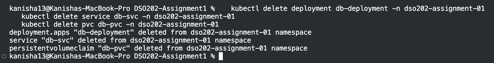

2. Created a new headless Service and a StatefulSet for the database instead.

   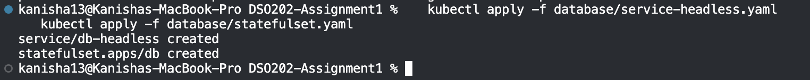

3. The first attempt failed because of a resource quota issue (explained in Challenges). Fixed it and reapplied.

4. Watched the new database pod, `db-0`, come up and reach `Running`.

   

5. Checked that its storage was bound and that it had a stable, predictable network name.

   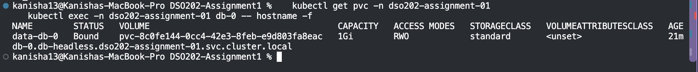

### Part B — ConfigMap: point backend at the new database

6. Updated the app's configuration to point at the new database address, and restarted the backend and frontend so they'd pick up the change.

   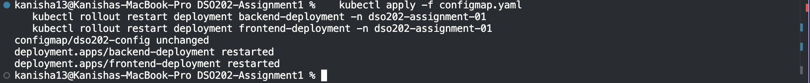

### Part C — Ingress: replace NodePort with a single entry point

7. Installed the Ingress controller, which is what actually reads routing rules and directs traffic.

   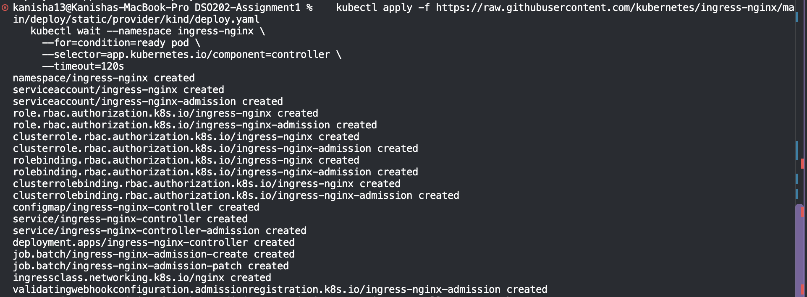

8. Switched the frontend back to a normal internal Service, then created the Ingress rule so one address routes `/api` to the backend and everything else to the frontend.

   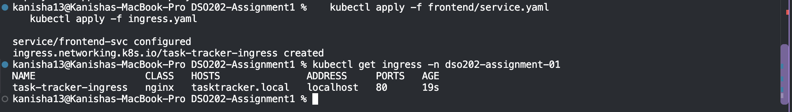

9. Checked the Ingress rule and confirmed it found real, healthy pods behind both routes.

   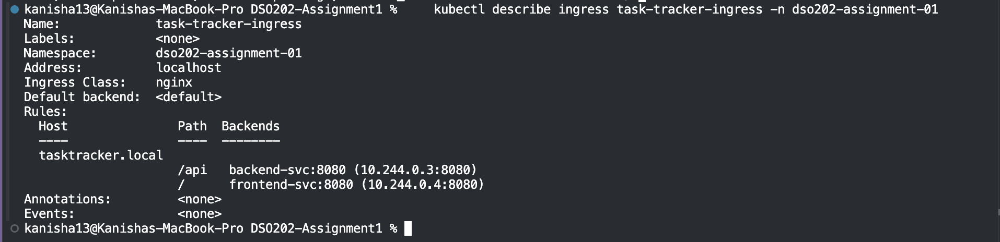

10. Opened the app through the Ingress in the browser — it briefly failed with "Backend Unreachable."
    
    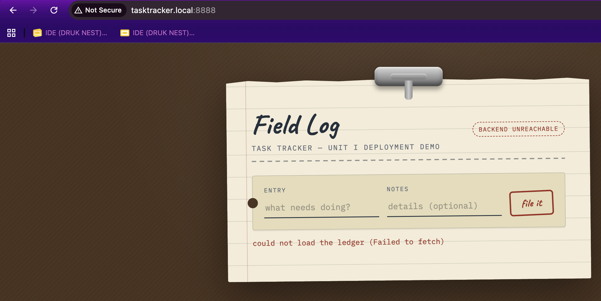

11. Traced the failure to a timing gap during a backend restart, not a real routing problem. Retested once the backend pod was fully ready, and it worked.

    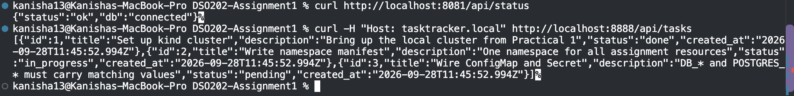

### Part D — RBAC: least-privilege access for the backend

12. Created a dedicated identity (Service Account) for the backend with only the minimum permissions it needs, and set the backend to use it.

    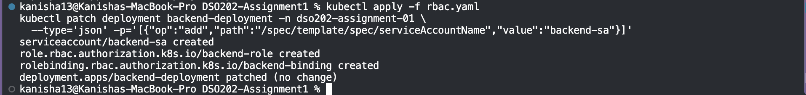

13. The rollout got stuck and didn't apply right away — diagnosed and fixed (see Challenges). Confirmed afterward that the backend was actually running under its new identity.
    
    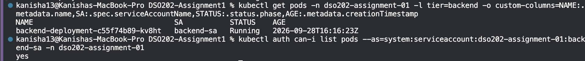

14. Tested that identity's permissions directly: it can view pods in its own namespace, but can't delete anything, and has no access at all outside its namespace.
    
    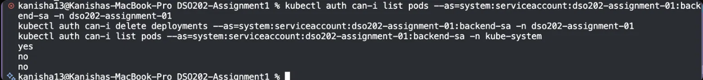

### Verifying database persistence properly

15. Created a new task, then deleted the database pod on purpose to see if it would come back on its own.
    
    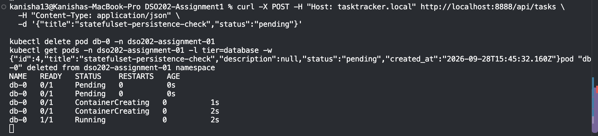

16. Confirmed the task was still there after the pod came back — proving the data survives even if the pod doesn't.
    
    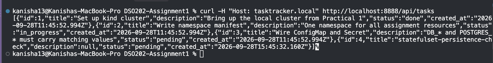

## Challenges Faced and Solutions

**Database pod wouldn't get created at all.**
The StatefulSet existed, but no pod ever appeared. The reason turned out to be a namespace rule requiring every container to declare how much CPU and memory it's allowed to use — the database's container didn't have this set, so it was silently rejected. Fixed by adding those limits directly.

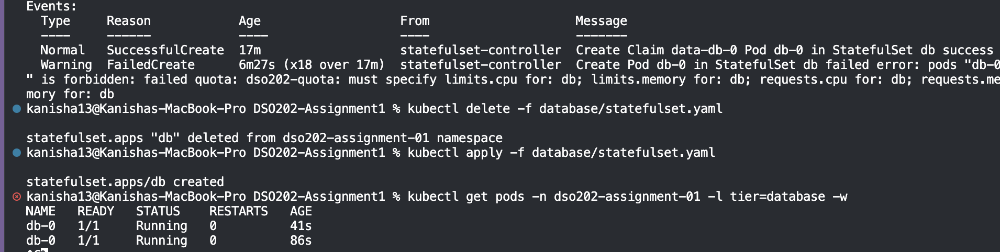

**Lost the earlier test data during the database migration.**
Switching from the old setup to a StatefulSet meant deleting the old storage, since the new setup manages its own storage differently. This meant the test task created during Part 1 was gone, replaced by the database's default startup data. This was an expected, one-time side effect of the migration — not a flaw. Verified afterward that the new setup keeps data safe going forward by creating a new task and confirming it survived a pod deletion.

**Ingress briefly returned a "Bad Gateway" error.**
The Ingress controller's own logs showed exactly why: at that exact moment, the backend was mid-restart and briefly had no running pod to send traffic to. Not a routing mistake — just bad timing during a restart. It worked cleanly once retested.

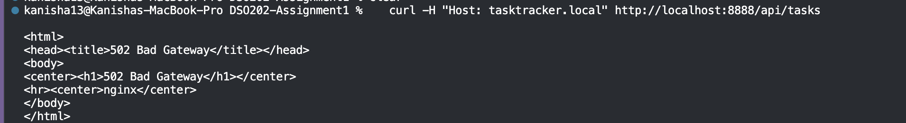

**RBAC change didn't actually apply at first.**
After setting the backend to use its new limited-permission identity, the change looked successful but the running pod was still using the old, default identity. Checking directly showed the rollout was stuck — for the same reason as the database issue earlier: the backend's container was also missing its CPU/memory limits, so the namespace quota was quietly blocking the new pod from being created. Fixed the same way, by adding those limits, which let the rollout complete. This was caught by checking the pod's actual identity directly instead of trusting that the change had worked.

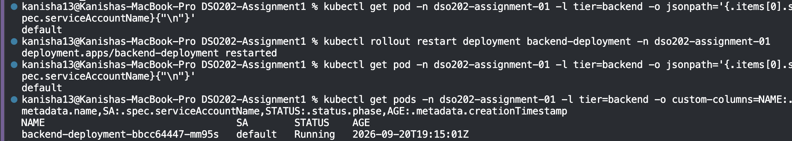

## Conclusion

The main shift from Part 1 to Part 2 wasn't learning new YAML syntax — it was learning to reason about why a given resource type exists instead of another. The StatefulSet conversion showed exactly what a plain Deployment with a separate storage volume can't do: give a pod a name and identity that survive it being recreated, not just data that survives. The Ingress migration replaced three separate exposed ports with one clean entry point, and diagnosing the "Bad Gateway" error along the way was a real, hands-on version of the kind of troubleshooting covered in the lectures — the fault turned out to be downstream of the Ingress entirely. The RBAC section ended up teaching the most unexpected lesson: the same quota rule that blocked the database earlier quietly blocked the RBAC rollout too, and it only got noticed because the pod's actual state was checked directly instead of trusting that a command reporting "success" meant the change had truly taken effect.