## Objective

Rebuild the Part 2 deployment using the Unit 4 tools for package and configuration management, Kustomize and Helm, instead of applying a fixed set of raw YAML files. The aim was to deploy the same Task Tracker app (StatefulSet database, backend, frontend, Ingress, RBAC, quota) as two environments, dev and prod, from one shared definition, first with Kustomize overlays and then with a parameterised Helm chart. I also wanted to use the release features that raw `kubectl apply` doesn't give you: hashed ConfigMaps, upgrade history, failure detection and rollback.

## Introduction

In Part 2 every environment would have needed its own copy of each manifest, with names, namespaces, replica counts and passwords edited by hand. Unit 4 fixes that by separating what stays the same from what changes. Kustomize does it by patching: a `base` holds the common manifests and each `overlay` patches only what differs. Helm does it by templating: one chart with a `values.yaml`, and a small values file per environment. Both were built from the Part 2 manifests, so the app and its images (`sarojsanyasi/dso202-*:1.0`) are unchanged. Everything was deployed to a fresh kind cluster, `dso202-a3`, and each environment got its own namespace.

## Steps Involved

### Part A — Project layout

1. Created two new directories next to the Part 2 files: `kustomize/` (a `base` plus `overlays/dev` and `overlays/prod`) and `helm/task-tracker/` (a chart with templates and three values files). The Part 1 and Part 2 files were left as they were.

   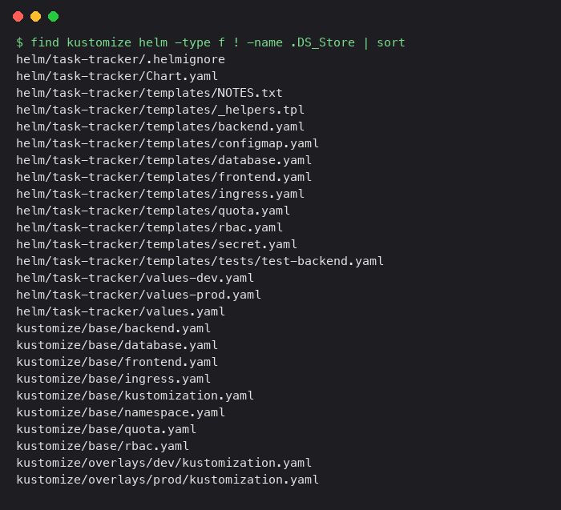

2. Checked the tools and the cluster.

   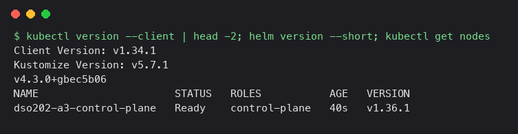

### Part B — Kustomize

3. Built the base from the Part 2 manifests. The ConfigMap and Secret are no longer written by hand. They come from `configMapGenerator` and `secretGenerator`, so their names get a content hash appended. The backend now runs as its own ServiceAccount, every container has CPU and memory limits (the quota problem from Part 2), and the backend and database have readiness probes.

4. Wrote the `dev` overlay: namespace `task-tracker-dev`, name prefix `dev-`, an `environment: dev` label and its own Ingress host. Previewed what it produces before touching the cluster.

   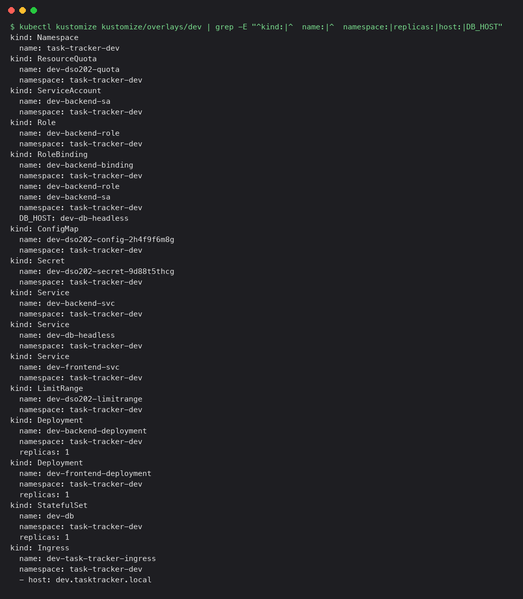

5. Deployed it with one command and waited for the database, backend and frontend to roll out.

   ```bash
   kubectl apply -k kustomize/overlays/dev
   ```

   

6. Checked everything that came up: pods, the database PVC created by the StatefulSet, the Ingress, the ServiceAccount, and the generated ConfigMap and Secret.

   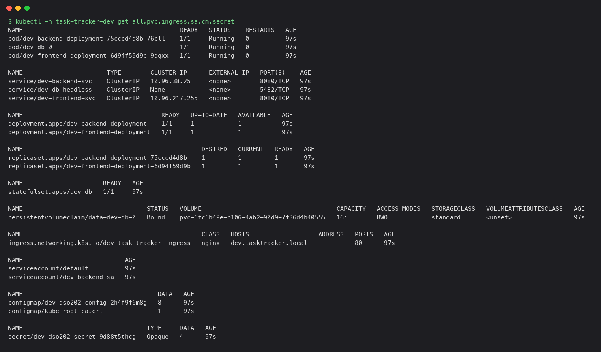

7. Confirmed the quota usage and that the backend pod runs under `dev-backend-sa`, not the default account.

   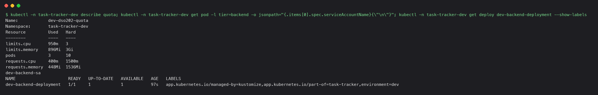

8. Tested the app through the backend with a port-forward: the status endpoint, then creating a task.

   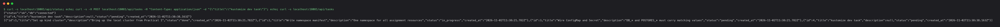

9. Deleted the database pod on purpose. The StatefulSet recreated `dev-db-0` and re-attached the same volume, and the new task was still there.

   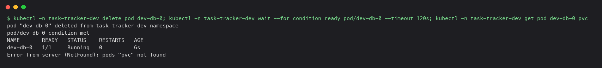

   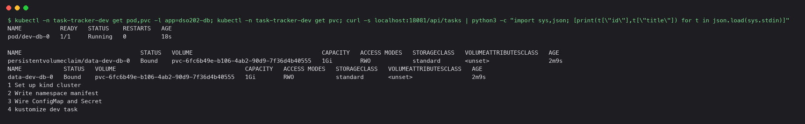

10. Demonstrated the hashed ConfigMap. Changed one value in the overlay and applied it. Kustomize created a new ConfigMap with a different hash, which changed the pod template, so both Deployments rolled automatically. Reverting the value and applying again rolled them back.

    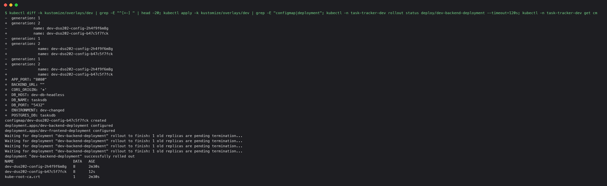

    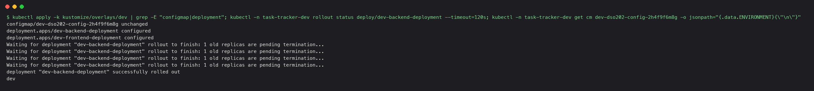

11. Wrote the `prod` overlay and deployed it. Same base, different patches: namespace `task-tracker-prod`, prefix `prod-`, 2 replicas for the frontend and backend, a larger quota, a different database password, a restricted CORS origin, a higher backend memory limit, the host `prod.tasktracker.local` and a `BACKEND_URL` pointing at that host (see Challenges).

    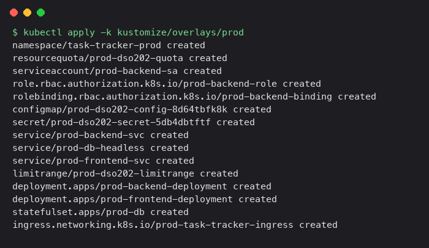

    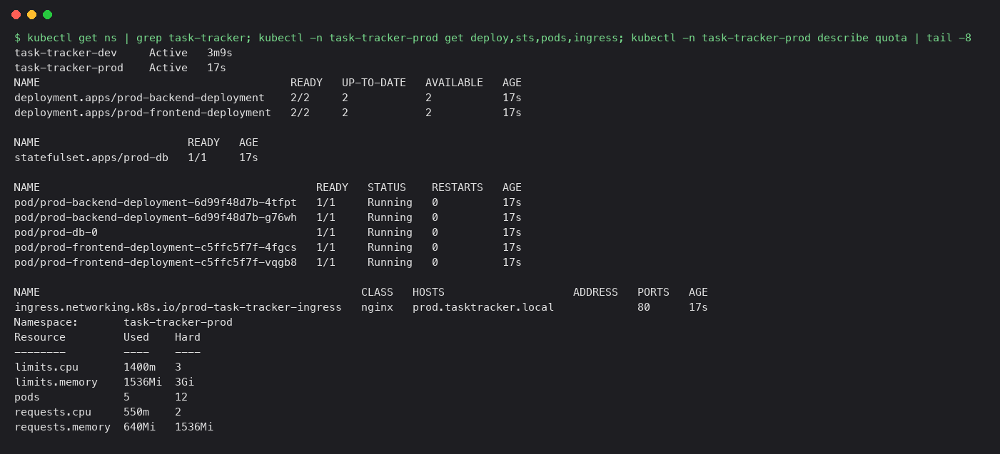

12. Checked that dev and prod are really separate. Prod has its own password, its own CORS origin and its own database, so the task created in dev doesn't exist there.

    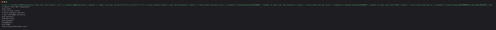

### Part C — Helm

13. Wrote the chart. All the values that differ between environments live in `values.yaml`: replica counts, image tags, resources, storage size, the Ingress host and the quota. The Ingress, RBAC and quota resources can each be switched on or off. The backend and frontend pod templates carry a checksum annotation of the ConfigMap and Secret, so a config change restarts them, which gives the same effect as Kustomize's hashed names. Added a `helm test` pod that curls the backend status endpoint. Linted the chart and rendered it without installing.

    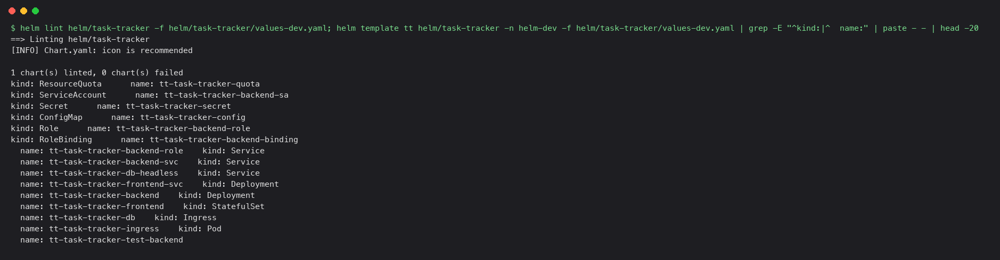

14. Installed the dev release into a new namespace.

    ```bash
    helm install tt helm/task-tracker -n helm-dev --create-namespace -f helm/task-tracker/values-dev.yaml --wait
    ```

    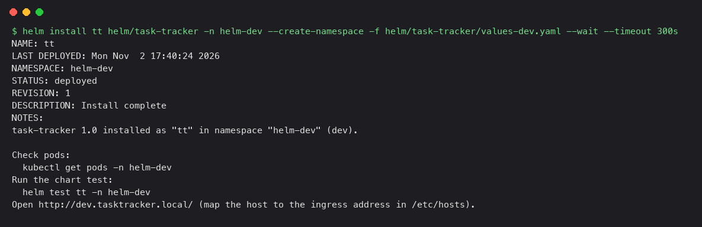

15. Checked the release and its resources.

    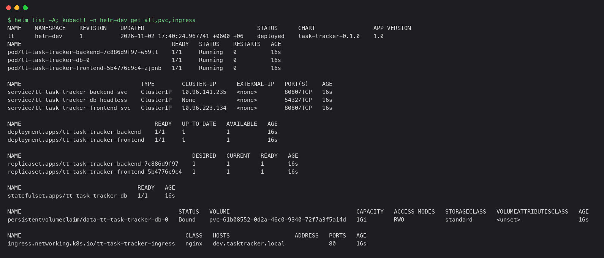

16. Ran the chart's test, which passed.

    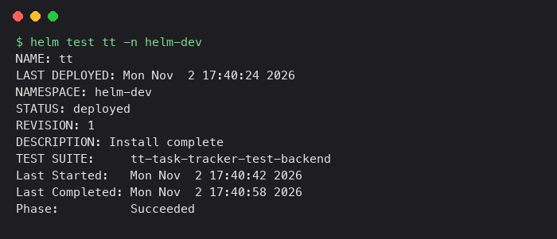

17. Upgraded the release with new values (backend scaled to 2 replicas, new CORS origin) and looked at the revision history.

    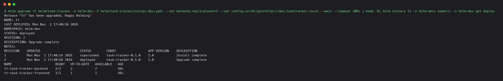

18. Ran a deliberately bad upgrade with an image tag that doesn't exist. Helm waited, detected that the Deployment never became ready, marked revision 3 as `failed`, and the two old backend pods kept serving traffic while the new one sat in `ImagePullBackOff`.

    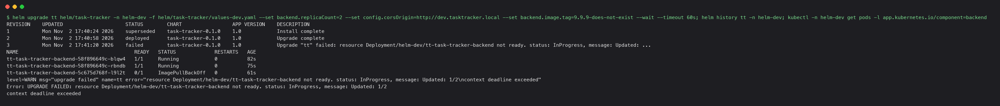

19. Rolled back to the last good revision. Helm records the rollback as a new revision (4) and the backend image is back to `1.0`.

    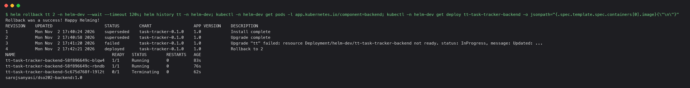

20. Installed the prod release from the same chart with `values-prod.yaml` and the password passed on the command line. Then created a task, deleted the database pod and confirmed the task survived.

    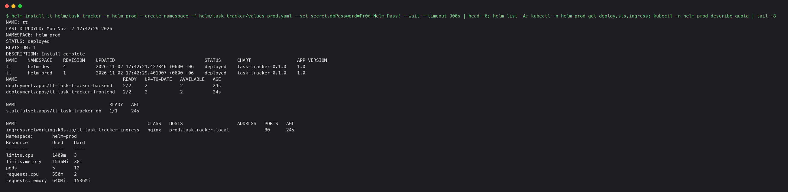

    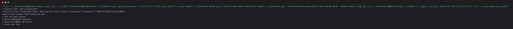

### Part D — Least-privilege check on both deployments

21. Asked the cluster what each backend ServiceAccount is allowed to do, for the Kustomize dev and Helm dev deployments. Both can list pods in their own namespace and nothing else: they can't delete pods, read secrets, or list pods in another namespace.

    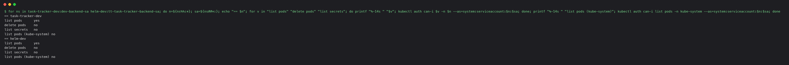

### Part E — Ingress routing (all four environments)

23. Installed the ingress-nginx controller for kind and waited for it to become ready. The kind node maps its port 80 to port 8088 on the Mac.

    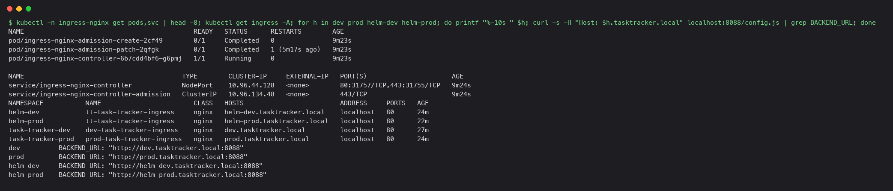

24. The two Helm releases initially used the same hostnames as the Kustomize ones, so the controller could not tell which deployment would answer. Gave the Helm values their own hosts (`helm-dev.tasktracker.local`, `helm-prod.tasktracker.local`) and upgraded both releases, so there are now four distinct hosts.

    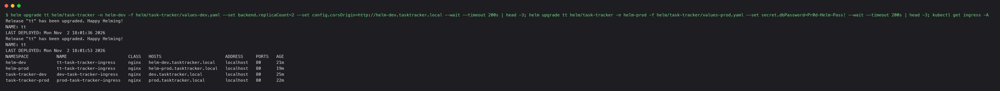

25. Tested all four hosts through the Ingress. `/` is served by the frontend, `/api/status` is routed to the backend and reports the database as connected, and an unknown host gets a 404.

    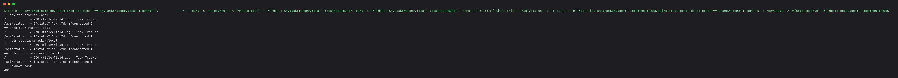

26. Created a task through the Ingress on the Helm prod host, then listed the tasks for it and for Kustomize dev. The new task is only in the prod database, which confirms the environments stay separate behind the same controller.

    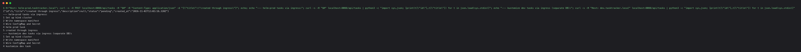

27. Opened each environment in a real (headless Chrome) browser, with the `*.tasktracker.local` names mapped to the local Ingress port. Each shows "BACKEND + DB ONLINE" and its task list. Screenshots are for Kustomize dev, Kustomize prod, Helm dev and Helm prod, in that order.

    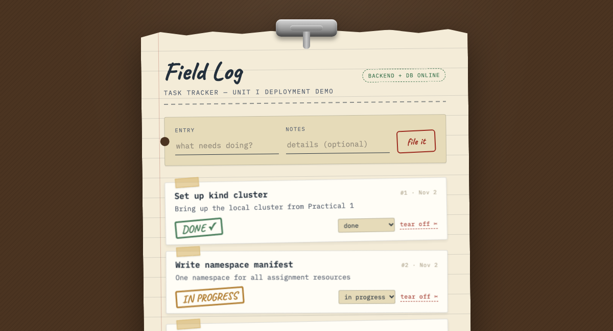

    

    

    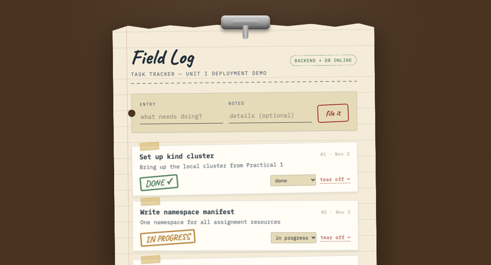

### Final state

28. All four environments (Kustomize dev and prod, Helm dev and prod) running side by side in separate namespaces.

    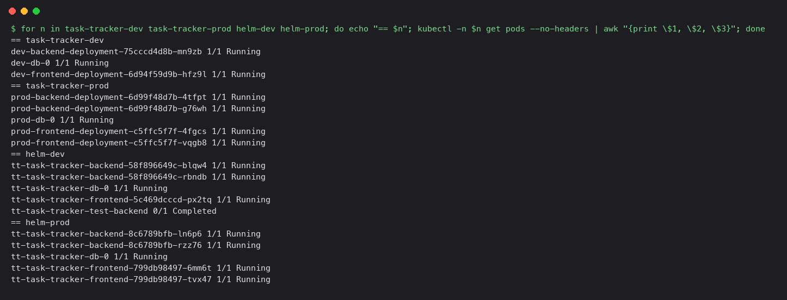

## Challenges Faced and Solutions

**The kind cluster wouldn't start.**
Creating `dso202-a3` failed repeatedly with "could not find a log line that matches Reached target Multi-User System", and once left a node that had no CPU or memory use at all. Docker Desktop had been paused when I started and was running about 40 other containers (another project's services plus four older kind clusters) inside a 6 GB VM. Stopping the unrelated containers and the old clusters, without deleting them, let a fresh create finish. One half-finished attempt also left a cluster where `kubernetes-admin` was "Forbidden" on everything, because kubeadm setup had been cut off partway. Deleting that cluster and creating it again cleanly fixed it.

**Name prefixes broke the database address.**
Kustomize's `namePrefix` renamed the Services to `dev-db-headless` and `prod-db-headless` and updated everything that references a Service object, but `DB_HOST` is just a string in a ConfigMap, so it still said `db-headless`. This showed up when reading the rendered output, before anything was deployed, and would have been a "database unreachable" error at runtime. Fixed by setting `DB_HOST` explicitly in each overlay's ConfigMap generator. In the Helm chart the same value is built from the release name, so it can't drift.

**Quota problems from Part 2 avoided.**
Part 2 lost time because containers without CPU/memory limits were silently rejected by the namespace quota. Every container in both deployments now has requests and limits, and the prod quota is raised to fit its extra replicas, so every rollout went through first time.

**The frontend said "Backend Unreachable" through the Ingress.**
The first browser test through the Ingress failed even though `/api/status` worked from curl. The frontend only knows where the backend is from `BACKEND_URL`, and its entrypoint script uses `${BACKEND_URL:=http://localhost:8080}`, which treats an empty value as unset. With the empty value left over from Part 2, the browser was calling `localhost:8080` and not the cluster. (In Part 2 this probably only appeared to work because another process on the Mac was already listening on port 8080.) Fixed by giving each environment an explicit `BACKEND_URL` that is its own Ingress address, for example `http://dev.tasktracker.local:8088`: in each Kustomize overlay's ConfigMap generator and in each Helm values file. Because the value lives in the ConfigMap, the frontend pods rolled automatically when it changed. The `:8088` is specific to this kind port mapping.

**Two deployments, one hostname.**
The Kustomize and Helm deployments first used the same `dev` and `prod` hostnames, so an Ingress controller can't tell which of two Ingresses in different namespaces should answer. Fixed by giving the Helm releases `helm-dev` and `helm-prod` hosts.

**The ingress controller needed a manual install.**
The sandbox I was working in blocked applying the ingress-nginx manifest from GitHub, so I asked for the install command and ran it outside the sandbox. After that the Ingress objects created earlier were picked up without being changed.

## Conclusion

The two tools solve the same problem in opposite ways, and building both made the difference concrete. Kustomize kept the manifests as plain YAML and expressed each environment as a short list of patches. That is easy to read, and the output can be previewed with `kubectl kustomize`, but a mistake like the `DB_HOST` string is invisible to it because it only understands references between objects, not text inside them. Helm moved the differences into values and gave a release a history, so a bad upgrade could be detected by `--wait` and undone in one command, which raw `apply` and Kustomize don't do by themselves. The cost is templates that are harder to read than the YAML they produce. The hashed ConfigMaps in Kustomize and the checksum annotations in Helm are two routes to the same useful behaviour, config changes that roll the pods automatically. The most practical lesson came from the infrastructure, not the tools: the failures that took longest were not YAML errors but a starved Docker VM and a half-initialised cluster, and both were found by reading logs and checking real state instead of assuming a "created" message meant the thing was working.
