# DSO202 Assignment 1 — Task Tracker Kubernetes Deployment Report

**Name:** Kanisha Pradhan
**Module:** DSO202
**Cluster:** kind (dso202-cluster)
**Namespace:** dso202-assignment-01

---

## Objective

Deploy a 3-tier Task Tracker application (frontend, backend, database) on a local Kubernetes cluster using declarative YAML manifests. The deployment needed to be namespace-isolated, use ConfigMaps/Secrets for configuration, keep database data on persistent storage, and stay within a defined resource quota. It also needed to demonstrate self-healing, service discovery, and a full CRUD cycle.

## Introduction

The app is a simple task tracker with three parts: a Postgres database, a Node/Express backend API, and a static frontend served by nginx. All three images were pulled from `sarojsanyasi/dso202-*` on Docker Hub. The goal of this assignment was to take these three pre-built images and wire them together properly inside Kubernetes — namespace, config, secrets, storage, quotas, services, and finally proving the whole thing actually works end to end.

## Steps Involved

1. Checked that Docker, kind, and kubectl were installed and working.

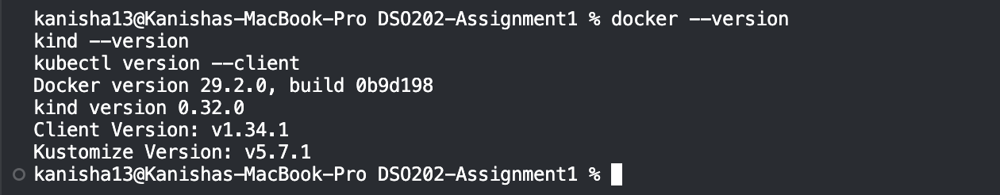

2. Created the kind cluster.
  
  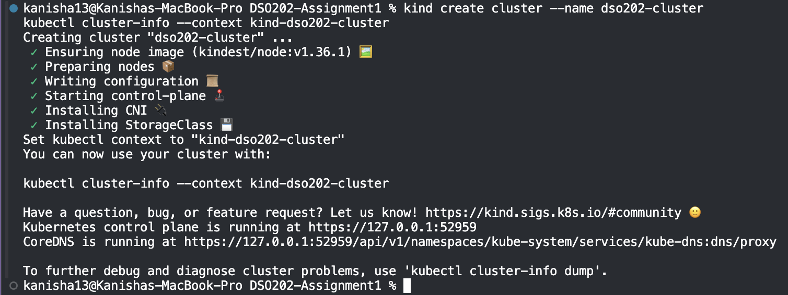

3. Created the `dso202-assignment-01` namespace.

  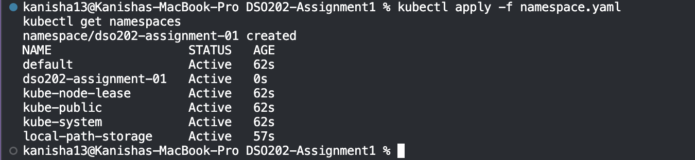

4. Applied the ConfigMap and Secret holding DB/app config and credentials.
   ```bash
   kubectl apply -f configmap.yaml
   kubectl apply -f secret.yaml
   ```

   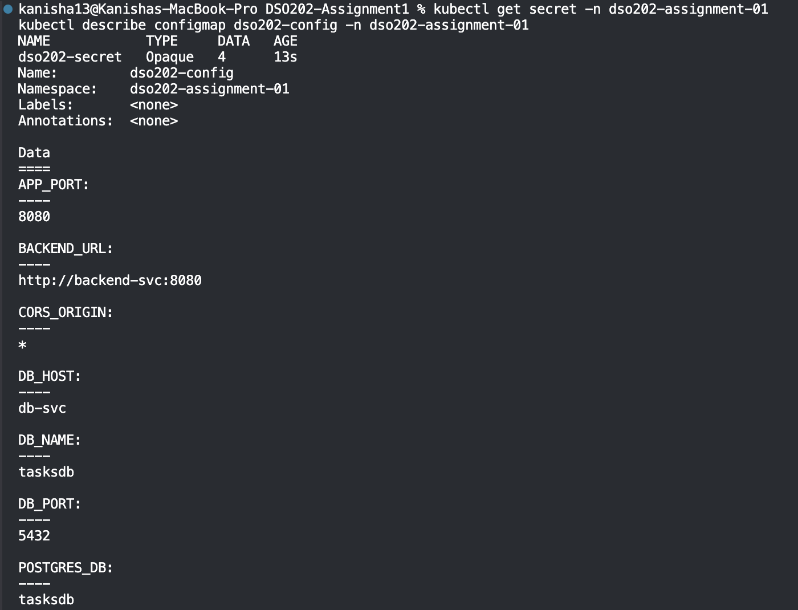

5. Applied the ResourceQuota and LimitRange for the namespace.
   ```bash
   kubectl apply -f quota.yaml
   ```
    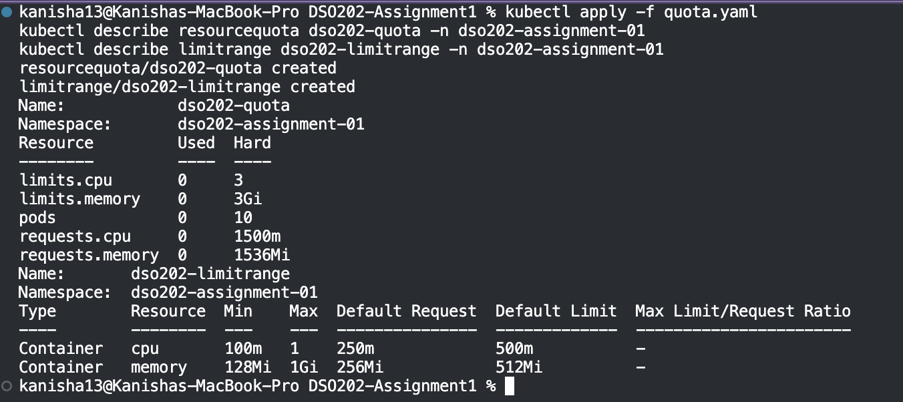

6. Deployed the database tier — PVC, Deployment, Service.
   
   Pod initially got stuck at 0/1 while the image was still being pulled from Docker Hub — it recovered on its own once the pull finished. PVC bound immediately.

   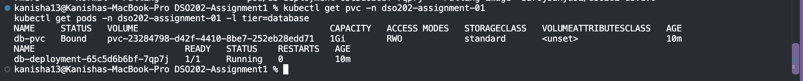

7. Deployed the backend tier — Deployment and Service.
   
   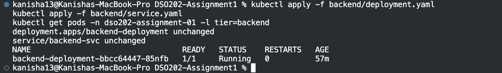

8. Deployed the frontend tier — Deployment and Service.
   
   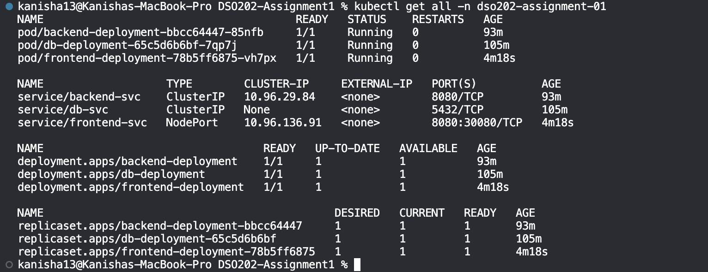

9. Opened the app in browser and hit "Backend Unreachable."

   Root cause: `BACKEND_URL` was set to `http://backend-svc:8080`, which only resolves inside the cluster, not in a browser.
   
   Fixed by changing `backend-svc` to `NodePort` (30081) and pointing `BACKEND_URL` at `http://localhost:30081`, then restarting the frontend deployment.

   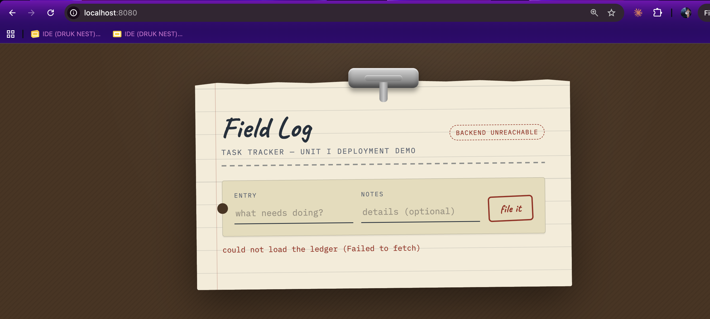

   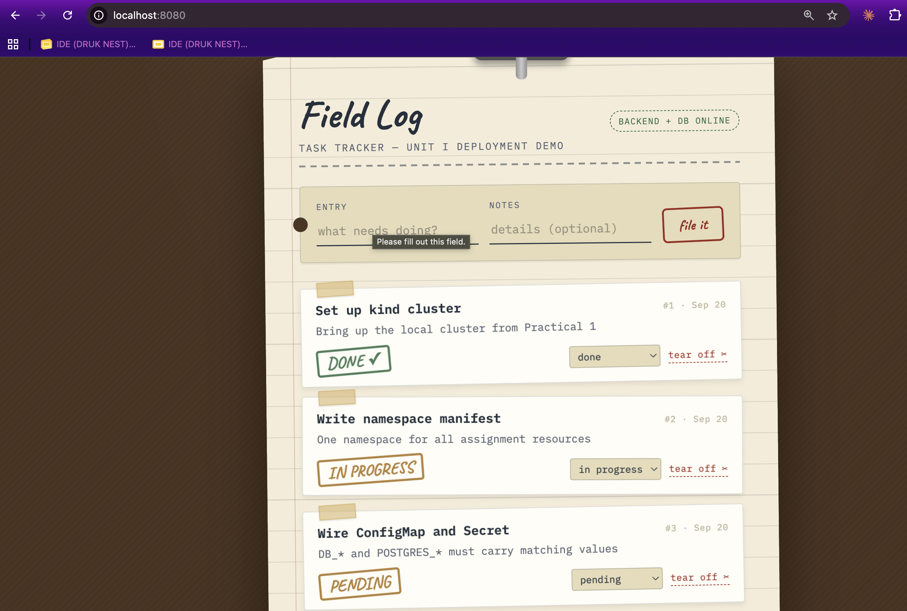

   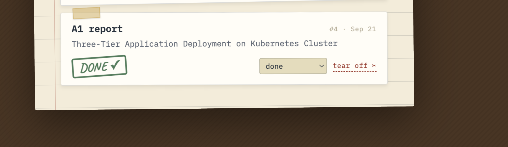


10. Full CRUD cycle via curl against the port-forwarded backend (`/api/tasks`).
    
    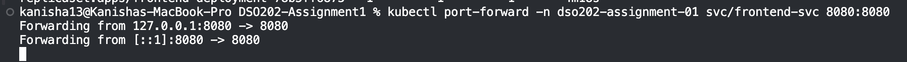

    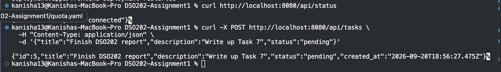

    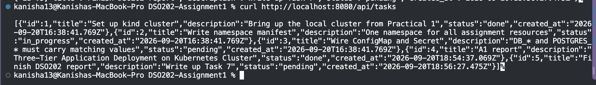

    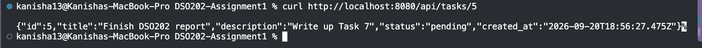
    
    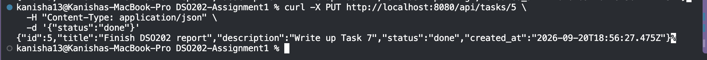

    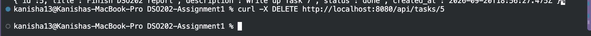

    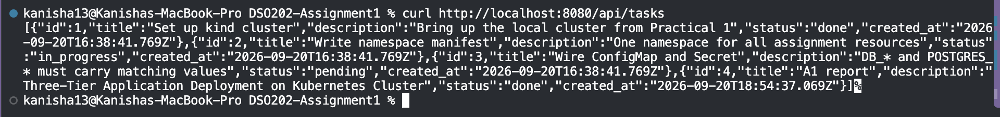

11. Verified service DNS resolution from inside the frontend pod.
    
    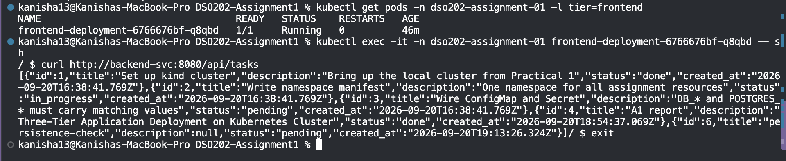

12. Demonstrated self-healing and data persistence.
    Created a task, deleted the backend pod, watched the ReplicaSet recreate it, then confirmed the task was still there.
    
    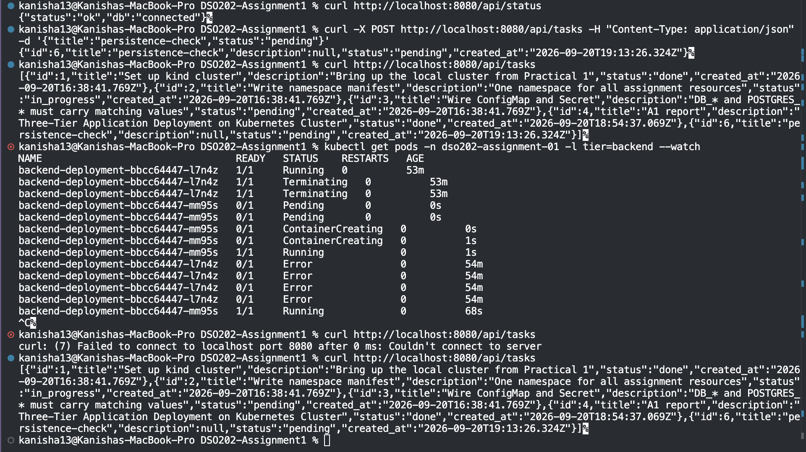

13. Declarative vs. imperative comparison, using the ResourceQuota.
    
    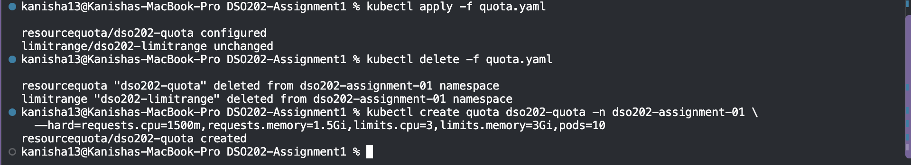

## Challenges Faced and Solutions

**Database pod stuck at 0/1 (ContainerCreating).**
The PVC bound fine right away, but the pod itself sat waiting on the image pull for several minutes with no error. Checked `kubectl describe pod` and saw it was still on `Pulling image` — just a slow first pull from Docker Hub. It resolved on its own once the image finished downloading. Learned to check `describe pod` events before assuming something's broken.

**Frontend showing "Backend Unreachable."**
This one wasn't a cluster problem — the frontend JS runs in the browser, and it was trying to reach `backend-svc`, a hostname that only means something to Kubernetes' internal DNS. The browser had no way to resolve it. Fixed by exposing the backend on a NodePort and pointing `BACKEND_URL` at `localhost:30081` instead, so the browser could reach it directly.

**Wrong API paths in curl testing.**
Initially guessed the routes were mounted at `/tasks`. Checked the actual backend source (`server.js`, `routes/tasks.js`) and found they're mounted under `/api/tasks`, with a separate `/api/status` health check. Used the real routes for the CRUD testing.

## Conclusion

This assignment made the difference between "the pods are running" and "the app actually works" a lot clearer. Getting pods to `Running` was the easy part — the real learning was in things like realizing a Service's internal DNS name is invisible to anything outside the cluster, or that a stuck pod isn't necessarily broken, just slow. Namespaces, ConfigMaps, and Secrets kept configuration cleanly separated from the app images, the PVC proved database data survives pod restarts, and the self-healing test showed the ReplicaSet doing its job without any manual intervention. Overall it was a good hands-on look at how the different Kubernetes objects depend on and reinforce each other in a real multi-tier deployment.